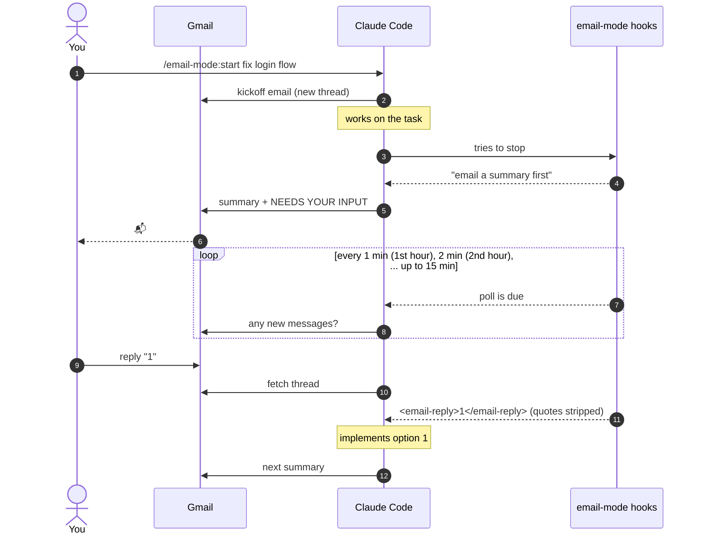

<h1 align="center">📬 email-mode</h1>

<p align="center">
  <strong>Talk to Claude Code by email.</strong><br>
  Start a session, walk away, and keep it going from your phone.<br>
  <sub>by <a href="https://www.linkedin.com/in/dazoulay/">David Azoulay</a></sub>
</p>

<p align="center">
  <a href="https://claude.com/claude-code"></a>
  <a href="LICENSE"></a>
  
  
</p>

<p align="center">
  <a href="#quick-start">Quick start</a> •
  <a href="#commands">Commands</a> •
  <a href="#configuration">Configuration</a> •
  <a href="#how-it-works">How it works</a> •
  <a href="#security--privacy">Security</a> •
  <a href="#faq">FAQ</a>
</p>

---

`email-mode` gives each Claude Code session its own Gmail thread. Whenever Claude finishes working, it
emails you a short summary there. If it needs a decision, it asks in the email. **Reply from anywhere,
and your reply goes back to Claude as if you'd typed it in the terminal.**

```text
Subject: [email-mode] my-app · em-c949 · fix login flow

NEEDS YOUR INPUT: The session cookie can be fixed two ways:
1) Shorten the expiry to 1h and add a refresh endpoint
2) Keep 24h expiry and rotate the token on each request
Reply with a number or free text.

Summary:
- Found the bug: the cookie was set without SameSite, so Safari drops it
- Added a failing test that reproduces it (auth.test.ts)
- Next: implement whichever option you pick

-- email-mode em-c949 · my-app
```

> You reply **`1`** from your phone. Within a minute Claude picks it up, implements option 1, and
> emails the next summary to the same thread.

## Highlights

- 🧵 **One thread per session.** A random id in the subject keeps sessions running in parallel apart.
- 📝 **A summary after every turn:** 2–6 bullets on what Claude did, found and plans next.
- 📄 **Long documents become links.** Plans, reports and documents you ask for are published as a
  private claude.ai page (an artifact or a Claude Docs doc), and the email links to it. Revisions keep
  the same link.
- ❓ **Decisions by email.** Questions arrive as numbered options, so you can answer with one digit.
- ↩️ **Clean replies.** Quoted history and signatures are removed before Claude sees your reply.
- ⏱️ **Polling that slows down when you're away.** Every minute for the first hour after activity,
  every 2 minutes the next hour, and so on, up to every 15 minutes. Polls that aren't due never reach
  the model, so they cost nothing.
- 🔒 **Only you can steer it.** Mail from any other sender on the thread is ignored.
- 🔑 **No API keys.** It uses the claude.ai Gmail connector you already have.

## Quick start

**1. Requirements**

- [Claude Code](https://claude.com/claude-code), signed in with a claude.ai account
- The **Gmail connector** enabled in claude.ai under *Settings → Connectors*. Check it with `/mcp`.
- `python3` 3.9+ (standard library only)

**2. Install** (inside Claude Code)

```text
/plugin marketplace add dazoulay/email-mode
/plugin install email-mode@email-mode
```

<details>
<summary>Other ways to install</summary>

From your shell:

```sh
claude plugin marketplace add dazoulay/email-mode
claude plugin install email-mode@email-mode
```

For one session only, from a local clone:

```sh
claude --plugin-dir /path/to/email-mode
```

</details>

**3. Use it**

```text
/email-mode:start fix login flow
```

On first run, Claude asks which address to email. Give it a task, walk away, and answer from your inbox.

## Commands

| Command | What it does |
|---|---|
| `/email-mode:start [title]` | Sends the kickoff email and starts watching the thread for replies |
| `/email-mode:stop` | Sends a closing email and stops watching |
| `/email-mode:config [key=value ...]` | Shows or changes settings. Plain English works too: *"turn off polling"* |

You can also stop by email: reply *"stop email mode"*.

## Configuration

Settings are stored in `~/.claude/email-mode/config.json` and apply right away, including to running
sessions.

| Key | Default | Description |
|---|---|---|
| `to` | *asked on first start* | Where emails go. The only sender whose replies are obeyed |
| `poll_enabled` | `true` | `false` stops checking for replies (summaries are still sent) |
| `poll_min_minutes` | `1` | Gap between polls in the first window after activity, and how much the gap grows each window |
| `poll_window_minutes` | `60` | How long each window lasts |
| `poll_max_minutes` | `15` | Longest gap between polls. Set it equal to `poll_min_minutes` to poll at a fixed rate |
| `stop_after_hours` | `24` | Pause polling after this much idle time (`0` = never). Typing in the terminal resumes it |
| `summarize_terminal_turns` | `true` | `false` only emails after work started by an email reply |

**Polling schedule.** With the defaults:

| Time since last activity | 0–1 h | 1–2 h | 2–3 h | … | 14 h + |
|---|---|---|---|---|---|
| Polls every | 1 min | 2 min | 3 min | … | 15 min |

Any activity starts it over at every minute: your email reply, a message typed in the terminal, or
Claude sending a summary. Polling pauses after 24 hours with no activity.

Emails are sent **from** the Gmail account the connector is signed in to, **to** the `to` address. The
two can be the same account.

## How it works

Only Claude itself can call the Gmail connector; hooks and scripts can't send or read mail. So the
plugin splits the work. Hooks run a small Python script that handles timing, state and text cleanup,
and tells Claude which Gmail call to make next.



| Hook | Role |
|---|---|
| `UserPromptSubmit` | Classifies each turn (poll, typed in the terminal, plugin command), applies backoff, drops polls that aren't due |
| `PostToolUse` | Links the session to its thread, records Claude's own message ids, detects and cleans new replies |
| `Stop` | Asks for the summary email when one is owed. Gives up after two tries, so it never loops |
| `PreToolUse` | Blocks Claude's question dialog while email mode is on, so a session never stalls waiting for a click |

Polls come from a session-scoped `CronCreate` job that fires every minute; the hook decides which of
those firings actually run. State is stored in `~/.claude/email-mode/sessions/`. The hooks load in every
session but do nothing until you run `/email-mode:start`.

## Security & privacy

> [!IMPORTANT]
> **Email replies are instructions.** Anyone who can send mail as your `to` address can direct Claude.
> Treat that inbox like terminal access, and keep 2FA on it.

- Messages on the thread from any other sender are never passed to Claude as instructions. Claude only
  sees a note that they were ignored.
- Summaries describe your work (file names, findings, short snippets) and pass through Gmail. Don't use
  email mode on code you can't send to your mailbox.
- Nothing leaves your machine except through the Gmail connector. There's no telemetry and no
  third-party service.

## FAQ

<details>
<summary><strong>Can Claude ask me for permission by email?</strong></summary>

No. Permission prompts are part of Claude Code's interface and can't be answered by email. If Claude
stops on one, it waits until you're back at the terminal. For unattended work, run in a permissive mode
(auto or accept-edits) or allowlist the tools you expect.
</details>

<details>
<summary><strong>Does the session need to stay open?</strong></summary>

Yes. The poll job lives in memory, ends when Claude Code exits, and expires after 7 days. Headless
`claude -p` runs exit after each prompt, so nothing polls between them.
</details>

<details>
<summary><strong>Why not poll every 10 seconds?</strong></summary>

Claude Code's scheduler can't fire more often than once a minute. Each poll that's due is also a small
model turn (cached context, one metadata call). That's 60 in the first hour after activity, 30 in the
second, 20 in the third, and so on. If that's more than you want, raise `poll_min_minutes` or shorten
`poll_window_minutes`.
</details>

<details>
<summary><strong>Can I run several sessions at once?</strong></summary>

Yes. Each session gets its own `em-xxxx` id and its own thread.
</details>

<details>
<summary><strong>My reply wasn't picked up.</strong></summary>

- Check that the session is still open and idle; polls only run between turns.
- Reply on the same thread. Changing the subject or forwarding can start a new thread that isn't watched.
- If the 7-day poll job expired, run `/email-mode:start` again.
- Start Claude with `EMAIL_MODE_DEBUG=1` to log hook activity to `~/.claude/email-mode/log.txt`, and run
  `python3 scripts/email_mode.py status --all` to see session state.
</details>

<details>
<summary><strong>No kickoff email arrived.</strong></summary>

Run `/mcp` and check that the claude.ai Gmail connector is connected, then `/email-mode:config` to check
the `to` address.
</details>

## Contributing

Issues and PRs are welcome. Reply-header formats from more mail clients and languages are especially
useful: add them to `_QUOTE_HEADERS` in `scripts/email_mode.py` with a test.

```sh
git clone https://github.com/dazoulay/email-mode && cd email-mode
python3 -m unittest discover -s tests             # unit tests, no network
claude plugin validate .
claude --plugin-dir .                             # load your working copy
EMAIL_MODE_HOME=/tmp/em claude --plugin-dir .     # use a separate state/config dir
```

```text
.claude-plugin/        plugin.json, marketplace.json
hooks/hooks.json       hook wiring
scripts/email_mode.py  state, backoff, reply detection, quote stripping, hook output
skills/                start / stop / config: the instructions Claude follows
tests/                 unit tests driven by fake hook payloads
```

## License

[MIT](LICENSE) © 2026 [David Azoulay](https://www.linkedin.com/in/dazoulay/)

<sub>Not affiliated with or endorsed by Anthropic. "Claude" and "Claude Code" are trademarks of Anthropic.</sub>
